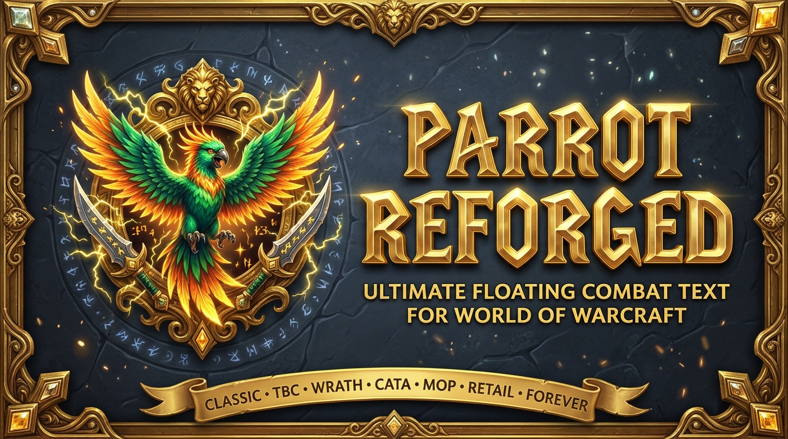

  

  # Parrot Reforged

  **The Iconic Floating Combat Text Addon — Completely Reforged for Retail 12.x (Midnight), Classic Forever & All Classic Flavors!**

  
  
  
  
  
  
  
  
  

---

**Parrot Reforged** brings the legendary **Parrot** Floating Combat Text (FCT) addon into the modern era of World of Warcraft — featuring a complete cross-expansion API compatibility layer (`Code/Polyfills.lua`), full **Retail 12.0+ (Midnight) `<secret number>` / `<secret string>` protection**, a combat-log-free fallback feed, taint-isolated private event dispatch, and seamless **ElvUI** & **AddOnSkins** integration.

---

## 🎮 Supported WoW Versions

- **Retail (Midnight `12.x` & The War Within `11.2.x`)**
- **Mists of Pandaria Classic (`5.5.x`)**
- **Cataclysm Classic (`4.4.x`)**
- **Wrath of the Lich King Classic (`3.4.x` / `3.8.x`)**
- **The Burning Crusade Classic Anniversary (`2.5.x`)**
- **Classic Era (`1.15.x`) & Classic Forever (`1.60.x` / `16001`)**

---

## ✨ Key Features

- ⚔️ **Highly Customizable Floating Combat Text**:
  - Separate **Incoming**, **Outgoing**, and **Notification** scroll areas with customizable animation styles (*Parabola, Straight, Rainbow, Sprinkler, Pow, Angled, Alternating, Static, Action*), direction, speed, font, outline, shadow, and icon placement.
  - Intelligent **Event Throttling**, **Damage/Heal Filters**, **Crit Sticky Styling**, **Only Show Crits**, and **Hide Throttle Text** options.
- 🛡️ **Full Retail 12.0+ (Midnight) & Forever Secret-Value Compatibility**:
  - Two-pass **Secret-Safe Tag Substitution Engine (`replaceTags`)** in `Code/CombatEvents.lua` that resolves normal tags first and concatenates `<secret number>` / `<secret string>` values via `..` without triggering `invalid replacement value (a secret)` errors in `string.gsub`.
  - Comprehensive `Compat.IsSecretValue`, `Compat.SafeNumber`, `Compat.SafeUnitName`, and `Compat.SafeUnitGUID` guards across combat events, auras, cooldowns, triggers, and display frame measurements.
  - **Combat-Log-Free Fallback Feed (`Code/CombatFeedFallback.lua`)**: Keeps floating combat text working via `UNIT_COMBAT`, `UNIT_SPELLCAST_SUCCEEDED`, and `C_DamageMeter` even when `COMBAT_LOG_EVENT_UNFILTERED` is restricted.
- 🎯 **Powerful Trigger & Cooldown Alert Engine**:
  - Class- and spec-aware triggers across Retail specializations and Classic talent trees (`1..3`), including **Warrior Stance** conditions, low health/mana warnings, reactive ability procs, and spell cooldown completion alerts.
  - Built-in `DDI-Font` and `DDI-Sound` AceGUI preview widgets (`LibSharedMedia-3.0`) with zero external `LibDDI-1.0` dependency required.
- 🎨 **ElvUI, AddOnSkins & LibSink-2.0 Integration**:
  - Styled scroll-area movers (`Transparent` template), automatic ElvUI font/icon-texcoord inheritance, `LibDBIcon-1.0` minimap button, Retail Addon Compartment menu, and full `LibSink-2.0` output target registration.

---

## ⌨️ Slash Commands

| Command | Description |
| :--- | :--- |
| `/parrot` | Open the Parrot Reforged configuration window |
| `/parrot test` | Trigger sample combat text messages in all active scroll areas |
| `/parrot toggle` | Enable or disable Parrot Reforged |
| `/parrot errors` | Display any captured internal error logs |

---

## 📜 Credits & License

- **Original Authors**: ckknight, profalbert, nebula
- **Reforged Modernization**: **gOOvER** ([goover.dev](https://www.goover.dev))
- **License**: [GNU Lesser General Public License v2.1 (LGPL-2.1)](LICENSE)
- **Support Development**: [donate.goover.dev](https://donate.goover.dev) • [Ko-fi](https://ko-fi.com/oldnoob) • [Buy Me a Coffee](https://www.buymeacoffee.com/goover)

